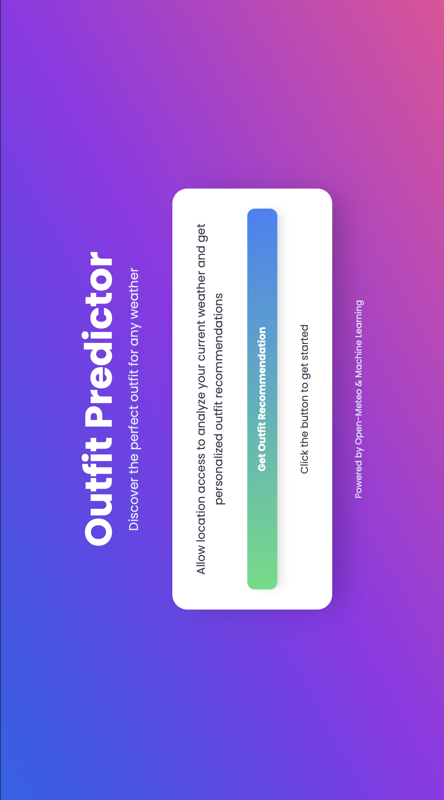
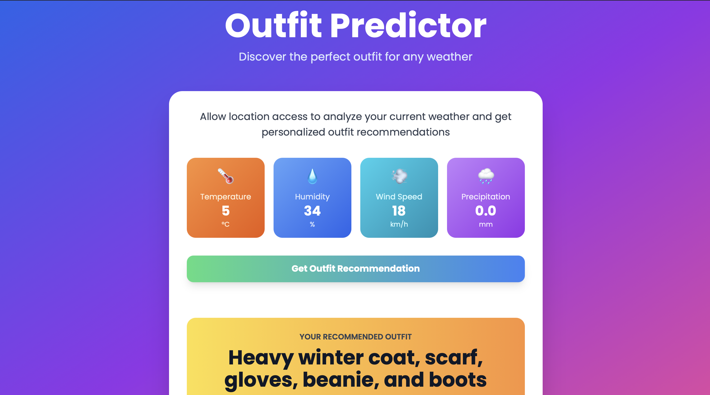

# WEATHER OUTFIT RECOMMENDER

A simple web application that recommends an outfit based on real-time weather data using a machine learning model. Built using **Flask**, **TailwindCSS**, and **scikit-learn**.


---

## Preview






---


## Features

- Real-time weather data via [Open-Meteo API](https://open-meteo.com/)
- Machine learning-based outfit prediction
- Responsive UI styled with TailwindCSS


---

##  How It Works

1. The user clicks the **"Predict Outfit"** button.
2. The browser fetches weather data from Open-Meteo, using geolocation data that it fetches via HTML5 Geolocation API
3. A POST request is sent to the Flask backend with:
   - Temperature
   - Humidity
   - Wind speed
   - Precipitation
4. The backend loads a trained `RandomForestClassifier` and label encoder.
5. The model predicts the best outfit based on input.
6. The predicted outfit is displayed on the frontend.

---

###  Prerequisites

Make sure you have:

- Python 3.7 or above
- pip (Python package manager)
- Git (to clone the project, or download ZIP)

---

### 1. Clone or Download the Repository

If using Git:

```bash
git clone https://github.com/yourusername/weather-outfit-predictor.git
cd weather-outfit-predictor
````
---

### 2. Train the model

```bash
python train_model.py
````
---
### 3. Start the flask server

```bash
python main.py
```

---
